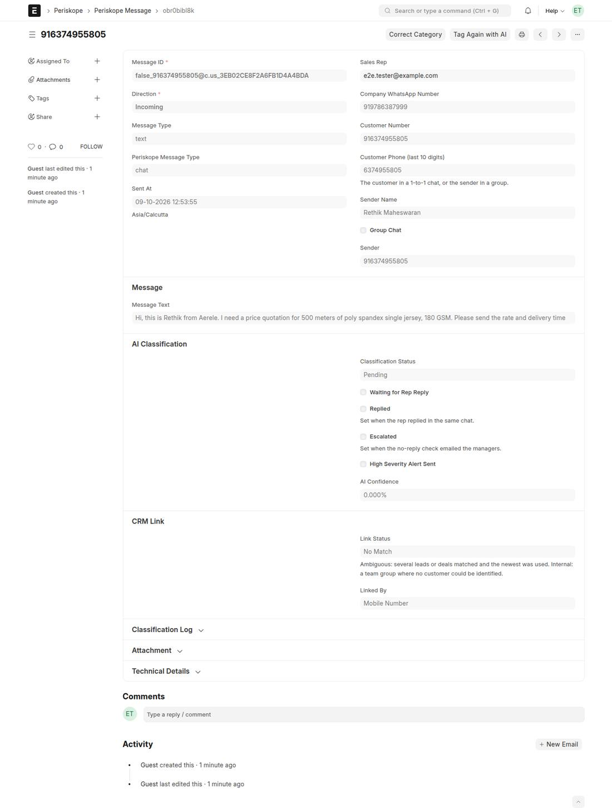
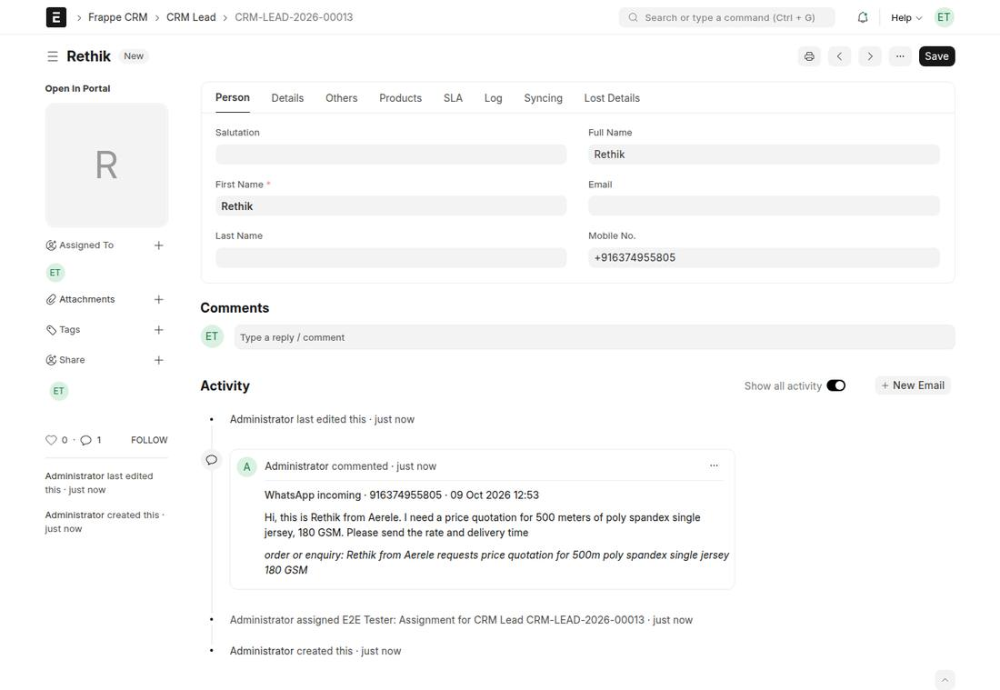
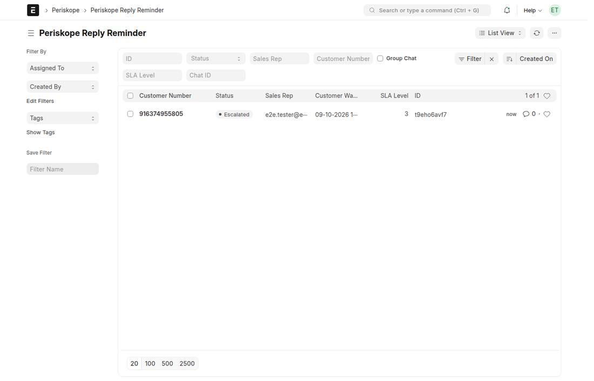
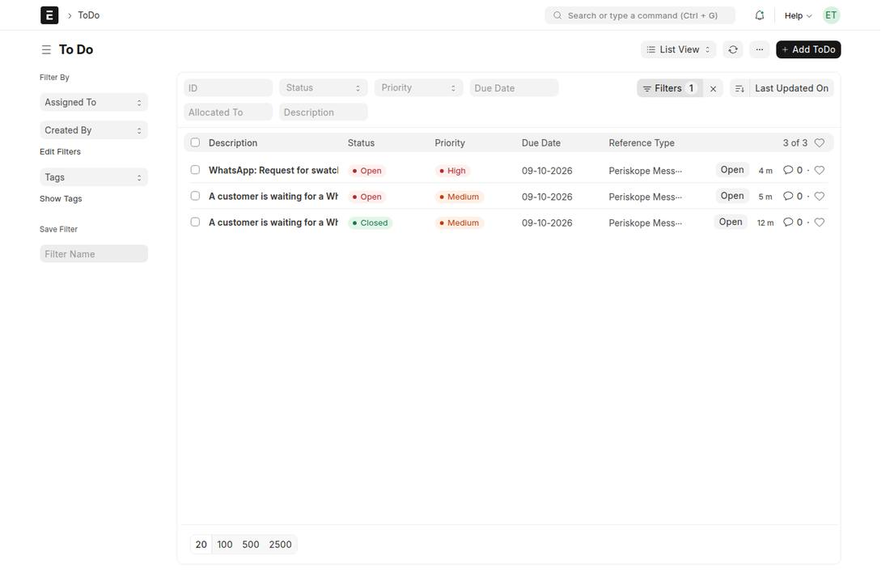
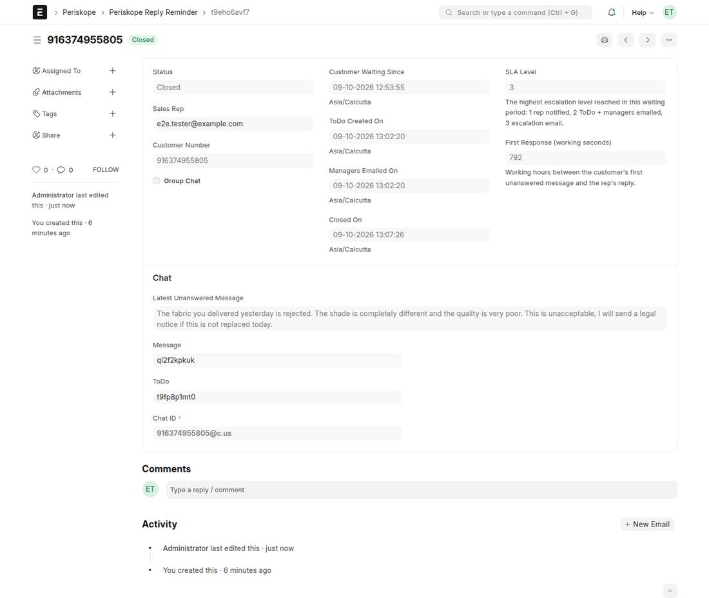
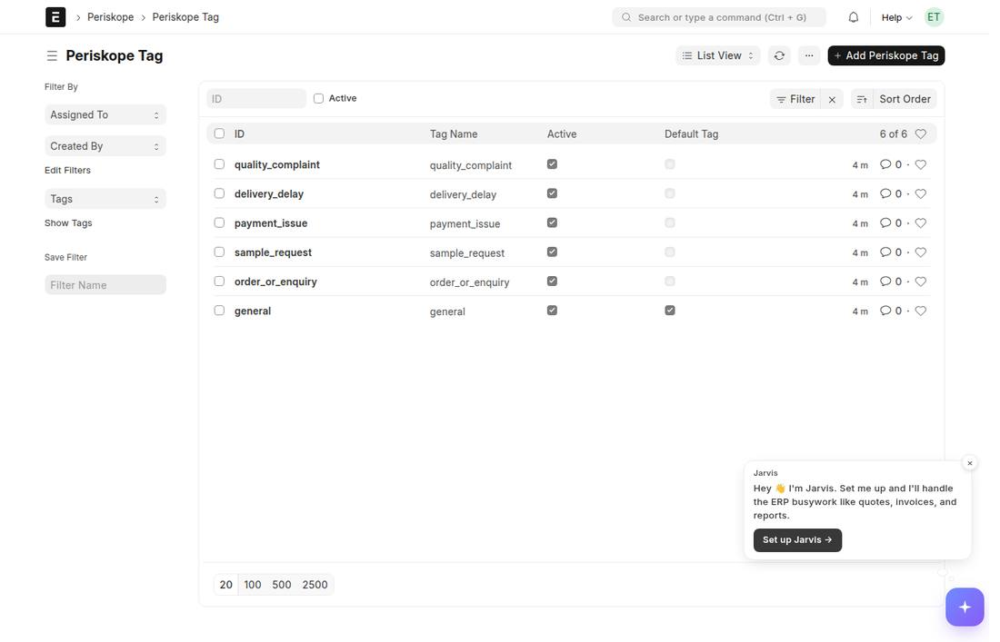
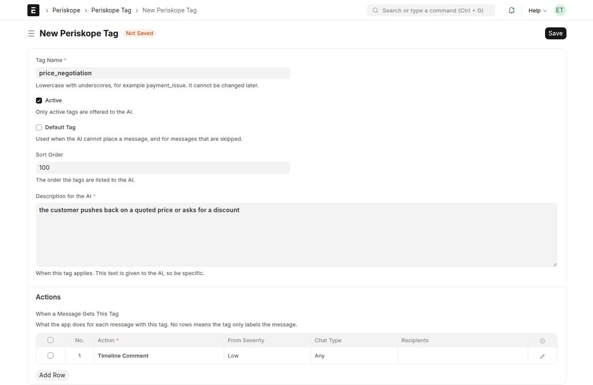
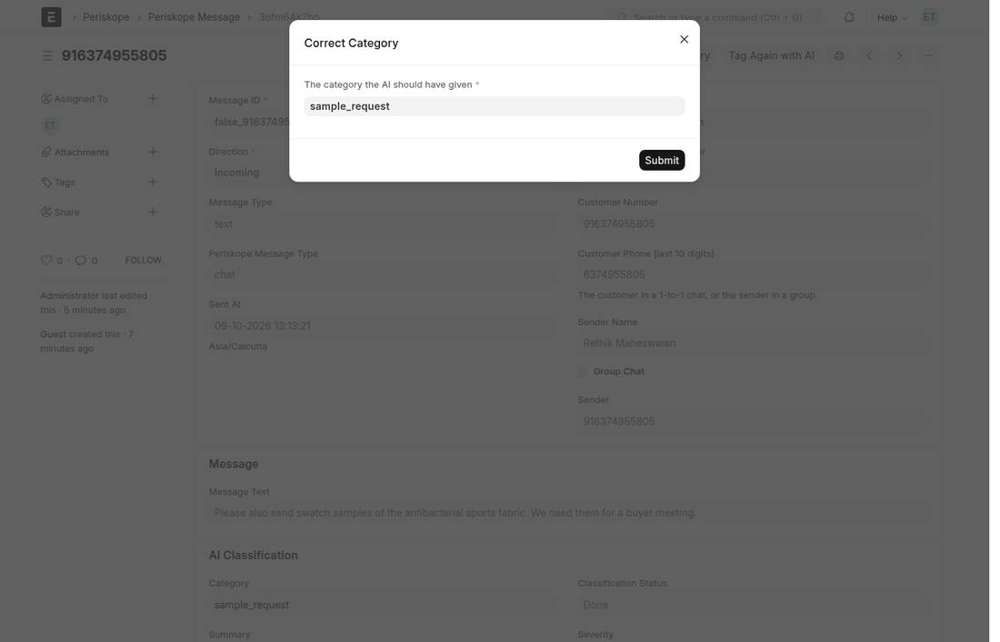
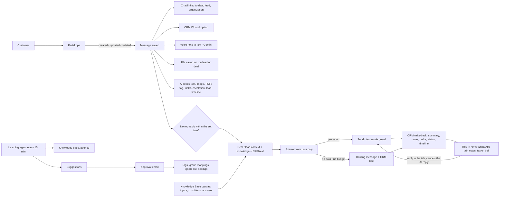

<div align="center">
	<h1>
		<br>
		<a href="https://github.com/rs-rethik/Periskope-Connector">
			
		</a>
		<br>
		Periskope Connector
	</h1>
	<h3>
		see every WhatsApp conversation your sales team has, inside Frappe CRM
	</h3>
	<h5>
		no WhatsApp Business API needed - reps keep using the WhatsApp they already use
	</h5>
</div>

<div align="center">
	<a target="_blank" href="#license" title="License: AGPL-3.0"></a>
	<a target="_blank" href="https://www.python.org/downloads/" title="Python version"></a>
	<a target="_blank" href="https://frappeframework.com" title="Frappe version"></a>
	<a target="_blank" href="https://docs.periskope.app" title="Periskope docs"></a>
</div>

Sales conversations usually live on each rep's phone, so management cannot see them and handing a customer over to another rep is hard. Periskope Connector captures the WhatsApp messages on your reps' company numbers through [Periskope](https://periskope.app) and puts an AI agent in charge of them. The agent reads every message, image and document as it arrives, links it to the CRM lead or deal, and decides what happens next: it creates the tasks a message hands out, escalates problems to the managers or the MD, creates leads for new enquiries, keeps the CRM record up to date, and answers a customer when no rep has. There are no rules to maintain. Reps keep using the normal WhatsApp or WhatsApp Business app on their own company numbers.

## Table of Contents
* [Features](#features)
* [How it works](#how-it-works)
* [Installation](#installation)
* [Setup](#setup)
* [User Manual](#user-manual)
  * [What Periskope Connector does](#what-periskope-connector-does)
  * [Before you start](#before-you-start)
  * [Set it up](#set-it-up)
  * [Daily use](#daily-use)
  * [The WhatsApp inbox](#the-whatsapp-inbox)
  * [Customise it](#customise-it)
  * [The Flow diagram](#the-flow-diagram)
  * [The AI agent](#the-ai-agent)
  * [Reports and dashboard](#reports-and-dashboard)
  * [Keeping it healthy](#keeping-it-healthy)
  * [Troubleshooting](#troubleshooting)
  * [Reference](#reference)
* [Privacy](#privacy)
* [Roadmap](#roadmap)
* [Development](#development)
* [License](#license)

## Features

- **Message capture:** every message on a linked number, sent or received, is saved as a **Periskope Message** with its direction, sales rep, customer number and attachment details. Duplicate events are ignored; a background sweep recovers deliveries whose job was lost; an hourly back-fill reads each active chat's history from Periskope and saves messages a missed webhook never delivered (older ones with `periskope_connector.backfill.run --kwargs '{"days": 7}'`); a daily sync-health check emails you when a normally busy number goes silent.
- **The AI agent decides:** each customer message (text, image, PDF or voice note, in 1-to-1 chats and groups) goes to Claude as it arrives. One answer gives its tag, severity, mood and summary, and what to do: the tasks it hands out, whether to escalate and to whom, whether it is a new enquiry, whether it matters for the lead or deal, and what an attached document shows. The app carries that out; no rule on a tag or keyword decides anything. Every call's tokens are logged (**Periskope AI Usage**), and a monthly budget pauses the AI when reached.
- **Tasks from group chats:** work handed out in a team group ("@Vijay send 1300 kg to GST Sourcing today") becomes a CRM Task per job, on the customer's deal and assigned to the person mentioned.
- **Escalation:** the AI sends what a manager must act on to the **Manager Emails**, and what the owner must see to the **MD Emails**, at once, by email and bell. A customer left waiting climbs a fixed reminder ladder in working hours.
- **Attachments:** every image, document, video and voice note is saved in Frappe and attached to the lead or deal. The AI reads images and PDFs (invoices, quotations, purchase orders, screenshots) and puts what they show on the record's timeline.
- **CRM linking:** 1-to-1 chats match the customer's number against CRM Lead and Deal (indexed normalised fields, E.164 first so foreign buyers cannot collide; open deals before closed ones). Groups match by group name, sender number, the customer named in the text, or a lead/deal set on the **Periskope Group**. Messages the AI marks as mattering appear on the lead/deal timeline.
- **Lead capture:** the AI creates a lead for a new business enquiry from an unknown number. Other unknown 1-to-1 numbers land in the **Periskope Contact** queue; supplier and employee numbers (ERPNext) are ignored on their own.
- **Auto reply:** when no rep has answered a customer within the set time, the AI answers from the knowledge base and ERPNext data, or tells the customer a rep will reply and gives the rep a task.
- **Learning:** the knowledge base grows from the reps' answers on its own; changes to the configuration (tags, group mappings, ignored numbers, a few settings) are suggested and wait for an approver.
- **WhatsApp inbox:** every rep works the company numbers from one inbox at `/whatsapp` (a Frappe UI app, no Desk and no Periskope seat needed): chats per number, replies, private notes, status, assignment, teams, SLA and the CRM record beside the chat. Each rep sees only the numbers and chats given to them.
- **Visibility:** in the same app, managers get a dashboard, the reports (Tagging Review, Response Time, Open Escalations, Lead Source, AI Usage, Sync Health, Unmatched Numbers), Health with live figures, the Flow diagram, and a log of everything the agent did (**Periskope Agent Action**).

## How it works

```
Rep's phone (WhatsApp)
        |  linked with a QR scan
        v
    Periskope  --- message.created webhook (HMAC signed) --->  Periskope Connector
                                                                     |
                     +-----------------------------------------------+
                     v
        Periskope Message  --->  AI agent (Claude), at once: text, images, PDFs, voice
                     |                |
                     |                +-> tasks for the people mentioned, on the customer's deal
                     |                +-> escalation to the managers or the MD
                     |                +-> new lead, timeline comment, attachment summary
                     +--> file saved on the CRM Lead or Deal
                     +--> linked to a CRM Lead or Deal; unknown number -> contact queue
                     |
                     v
        No rep reply in time -> AI reply (or a holding message + task) -> reminder ladder
```

The webhook endpoint accepts calls from anyone but only acts on a request whose `x-periskope-signature` matches your signing secret. It writes nothing until the signature is verified, it is rate limited, and heavy work happens in a background job so Periskope gets its 200 immediately.

## Installation

Requirements:

- Frappe v15 or v16 with [Frappe CRM](https://github.com/frappe/crm) on the site (ERPNext optional: it only adds the Sales Person link and Supplier/Employee ignore lookups)
- A [Periskope](https://periskope.app) account with at least one linked WhatsApp number
- An [Anthropic API key](https://console.anthropic.com) for the AI agent
- A site that Periskope can reach over the internet for webhooks

Install the app with the [bench](https://github.com/frappe/bench) CLI — everything else is created for you (roles, custom fields, lead source, starting tags):

```bash
cd $PATH_TO_YOUR_BENCH
bench get-app https://github.com/rs-rethik/Periskope-Connector --branch develop
bench --site $SITE_NAME install-app periskope_connector
bench --site $SITE_NAME migrate
```

## Setup

Open `/whatsapp` and click **Settings** at the bottom of the sidebar (managers and admins), or open **Periskope Settings** in Desk (System Managers). The Desk form's **Setup** tab has four steps (connect Periskope, AI key and budget, the team, auto reply) with a status panel that shows what is still missing; **Advanced** holds the Periskope address, the voice-note key and the webhook events. **Health and flow** in the `/whatsapp` sidebar shows live figures and the whole pipeline as a diagram. Step-by-step instructions are in the [User Manual](#user-manual).

## User Manual

The manual below is for the people who set the app up and use it every day, with screenshots. It follows the order you need things: set up, daily use, customising, reports, keeping it healthy and troubleshooting.

### What Periskope Connector does

Your sales reps talk to customers on WhatsApp from their company numbers. Periskope Connector collects those conversations in Frappe so management can see them, and does the routine work around them.

1. **Captures** every message on a linked company number, sent or received, through [Periskope](https://periskope.app), with its images and documents.
2. **Reads** each customer message with AI as it arrives: a tag such as *quality_complaint*, a severity, the mood, a summary, and what an attached image or PDF shows.
3. **Links** the conversation to the right CRM lead or deal, and saves its files there.
4. **Decides and acts**: creates the tasks a message hands out, escalates to the managers or the MD, creates a lead for a new enquiry, keeps the record's notes, tasks and timeline up to date.
5. **Answers** a customer no rep has answered in time, and reminds the team when a customer still waits.

> **Note** The app sends a WhatsApp message only for the AI's replies (when **Reply to Customers** is on) and for a rep's reply typed in the WhatsApp app (`/whatsapp`). Test mode limits who can receive messages. Reps can keep using WhatsApp or WhatsApp Business as they do today.

##### Who uses it

| Person | What they do |
|---|---|
| System Manager | Sets the app up and changes its settings. |
| Sales Manager, WhatsApp Manager | Read the messages, reports and dashboard, correct tags, work the contact queue. |
| Sales rep | Answers chats in the WhatsApp app (`/whatsapp`), with the lead or deal beside each chat; gets tasks and bells in the CRM. |

### Before you start

Have these ready. Setup takes about fifteen minutes.

| You need | Why |
|---|---|
| A Periskope account on a plan that includes the API | Periskope only allows API access on a Pro or Enterprise plan. Without it the connection fails with a plan message. |
| At least one WhatsApp number linked in Periskope | This is the company number the reps use. |
| The site's public https address | Periskope sends messages to your site, so it must be reachable from the internet. For a test site, use a tunnel such as ngrok. |
| An Anthropic API key | The AI agent runs on it. Without it messages are captured and linked, but nothing is decided. |
| An outgoing Email Account on the site | Alerts and escalations are sent by email. Without one they fail and are logged in the Error Log. |
| The Frappe scheduler and a worker running | The AI analysis, saving files, auto reply, reminders and the hourly catch-up run as background jobs. |
| One company per site | Every manager sees every chat on the site. With ERPNext, set the **Company** on each WhatsApp Number so orders and quotations from its chats go to that company; separate businesses whose managers must not see each other's chats need separate sites. |

> **Important** The key, the signing secret and the Anthropic key are secrets. Enter them in the settings form yourself and do not share them.

### Set it up

Everything is configured on **Periskope Settings** (in Desk, or **Settings** in the `/whatsapp` sidebar, where each section of the form is a tab under *System*). The **Setup** tab has four steps, and the panel at the top shows which are done and what is still missing. The AI agent starts on its own once steps 1 to 3 are done; there is no switch for it.

| Step | What you enter | Check |
|---|---|---|
| 1. Connect Periskope | Tick **Enable Periskope Integration**, paste the **Periskope API Key** (Periskope console, Settings, Integrations, API), save. Under *Receive Messages* copy the **Webhook Signing Secret** from Periskope (Settings, Webhooks). | **Test Connection**: checks the key, fills the company numbers and registers the webhook. |
| 2. AI | The **AI Provider** and **AI API Key** (Anthropic), the model, and a **Monthly Token Budget**. Under *About Your Business*, a few lines on what you sell and to whom: the AI reads it before every decision. | **Test AI**: the result is shown in *AI Status*. |
| 3. Team | **Approver Emails** (who approves configuration changes the AI suggests), **Manager Emails** (get the AI's escalations), **MD Emails** (get what the owner must see), the **Default Sales Rep** and the rep for each company number. | The panel names any approver that is not an active user with an approver role. |
| 4. Auto Reply | **Reply to Customers**, and **Reply When No Rep Answers Within** (minutes). Working hours and days are used for due dates and for how long a customer has waited. | The panel shows whether the AI answers customers. |

A new install already contains the starting tags, so these four steps are all that is needed.

> **Important** The keys and the signing secret are secrets. Enter them in the form yourself and do not share them.

> **Tip** If the Webhook URL shows a local address, set the site's public address first (`host_name` in the site config, for example your ngrok address) and save again. Periskope can only call an https address.

#### What the AI decides, and what you still own

There are no rules to configure: no keyword rules, no actions on tags, no escalation table. The AI decides each case from the message, the conversation and the CRM record, and **Periskope Agent Action** shows everything it did.

| What | Who decides |
|---|---|
| Tasks, escalations, new leads, timeline comments, CRM notes and status | The AI, per message |
| The knowledge base for auto replies | The AI, from the reps' answers (you correct it on the **Knowledge Base** canvas) |
| Tags (categories for reports) | You, on **Periskope Tag**; the AI may suggest one, which waits for approval |
| Group to customer mapping | **Periskope Group**; the AI suggests, an approver confirms |
| Numbers to ignore | **Periskope Contact** with an *Ignored* status; the AI suggests, an approver confirms |

#### Test mode

Test mode is on until an admin switches it off (Setup tab, Test Mode). While it is on:

- a WhatsApp message (auto reply, holding message, or a rep's reply from the CRM) goes out only to the **Allowed Chats**; a group never gets one, even when it is listed. For every other chat the reply is prepared and logged as a dry run, and nothing is sent;
- the agent writes notes, tasks and status changes only for allowed chats; for the others (and every group) it logs what it would have written;
- email reaches only the **Allowed Emails**. Other recipients are dropped from every email the site sends.

Everything that was sent, blocked or only simulated is a row in **Periskope Agent Action**.

### Daily use

#### Messages

Read a conversation in the [WhatsApp inbox](#the-whatsapp-inbox). System Managers can also open **Periskope Message** in Desk: each message shows who sent it, the rep, the number, the text, and once tagged: the tag, severity, sentiment, a summary, and a link to the CRM lead or deal.


*A message as soon as it arrives, before the AI has read it.*


*The same message after tagging: tag, summary, products, customer name and the linked CRM lead.*

A message is **Pending** for the few seconds the AI takes to read it (a job every 5 minutes catches up on any that were missed). **Skipped** means it was not sent to the AI and the reason is shown, for example *Sent by the rep* or *Too short to tag*. Under *Media*, a message with a file shows the **Saved File** and, for an image or PDF, **What the Attachment Shows**.

#### In the CRM

A message is linked to a lead or deal by the customer's mobile number. Open the lead in Frappe CRM or in Desk: the messages that matter appear on its timeline with the AI summary, and its files are in **Attachments**.


*A WhatsApp message on the timeline of a lead in Frappe CRM.*


*The same lead in Desk, with the message and AI summary.*

For groups, the app looks for the customer by group name, by the sender's number, or by a customer name the AI finds in the text. You can also link a group to a lead or deal by hand in **Periskope Group**. Messages in a team group where no customer is found are marked *Internal*.

#### Unknown numbers: the contact queue

A number that is not on any lead, deal or contact goes to **Periskope Contact**. From a contact, use **Actions**:

| Action | What it does |
|---|---|
| Create Lead | Makes a CRM lead for the number, links all its earlier messages and adds one summary comment to the lead. |
| Link to existing | Writes the number onto a lead or deal you choose and links the history. |
| Ignore | Marks it personal, vendor, spam or internal. It stays out of the queue and is never turned into a lead. |


*A contact after a lead was created. Its status changes to Lead Created.*

When the AI sees a new business enquiry, the number goes straight to **Lead Created**. Anything else waits in the queue as **New**, and the digest email to the managers lists it each day.

#### Alerts you will receive

Alerts arrive both as email and as a bell notification in Frappe.

| Alert | When |
|---|---|
| AI escalation | The AI judges that a manager must step in (an angry customer, a complaint, a rejection) or that the MD must see it (a legal threat, a payment to someone else, a big order about to be lost). The email says why. One per message. |
| Reply reminder | A customer is waiting for a reply (see below). |
| Budget alert | The monthly AI token budget is reached. |
| Silent number | A normally busy company number has sent no messages today. |


*Alerts in the bell.*

#### When a customer is waiting

With **Reply to Customers** on, the AI usually answers first. When a customer still waits (the AI could only send the holding message, or auto reply is off), the app checks every 10 minutes during working hours and climbs a fixed ladder:

| Waiting (working time) | What happens |
|---|---|
| 1 hour | The rep gets a bell notification. |
| 3 hours | The rep gets a task and the managers get an email. |
| 8 hours | The MD gets an email. |
| 30 minutes, High severity | All four of the above, straight away. |


*Reply reminders: one row per waiting customer, with the level reached.*


*The ToDo created for the rep.*

When any rep replies in the chat, the reminder closes, its task is closed and the time to the first answer is recorded. A new customer message after that starts a fresh cycle. Group chats are followed up through their tasks instead.


*A closed reminder with the first-response time.*

### The WhatsApp inbox

Reps and managers work WhatsApp at **`/whatsapp`** (also in the Frappe apps switcher as *Periskope Connector*). It needs no Desk access and no Periskope seat: the one Periskope account stays the connection for all company numbers.

**Who sees what.** Managers (Sales Manager, WhatsApp Manager, System Manager) see every number. A Sales User sees the chats assigned to them, on any number, and a territory's sales rep also sees the chats assigned to the sales persons under them. On their own numbers (their **Agent** numbers or their team's numbers) they also see their team's chats when the team shares them, and the chats of leads and deals they own. Admins set agents, teams and numbers in **Settings**.

**Territory sales reps.** A chat or group nobody is assigned to goes to the sales rep of its customer's territory: the territory of its deal, lead or organization, whose **Territory Manager** (CRM Territory; the parent territory's when it has none) is the rep. Hand assignments and team rules are never replaced. The rep can hand the chat to the sales persons under their own Sales Person in ERPNext (Sales Person → Employee → user). To assign the existing chats once, quietly: `bench --site <site> execute periskope_connector.territory.assign_unassigned`.

**The inbox** has three panes: the chat list, the conversation, and the CRM record.

- The sidebar filters the list: *All open*, *My chats*, *Unassigned*, *Unanswered*, *Unread*, *SLA breached*, *My team*, one company number, or a saved view. Badges count each. **Conversations** shows the same chats as a table with bulk actions.
- **Reply** goes out from the chat's own number. Add a file, reply to a message, or insert a quick reply. Ticks show sent, delivered and read; a failed send says why and can be retried (connection errors are retried on their own). **New chat** starts one from a number you may use.
- A **note** is internal: only your team sees it and it is never sent to the customer. Type @ to mention a colleague and notify them.
- Set the **status** (Open, Pending, Resolved, Closed; a customer's new message reopens the chat), **assign** it, move it to a **team**, and add **labels**. The activity log keeps each change. The SLA badge shows when the next SLA deadline is due, or how late it is.
- The **CRM panel** shows the linked lead or deal (owner, status, value, AI summary, notes, open tasks). From it you can link the chat to another record, create a lead, add a note or task, change the status, or open the record in Frappe CRM. A lead or deal in Frappe CRM has an *Open WhatsApp inbox* button.
- Keys in a conversation: **r** reply, **a** assign to me, **e** resolve, **Esc** close the chat (it first leaves the typing box, cancels a reply or closes an open menu).

New messages, ticks and changes arrive live. The AI still replies to an assigned chat when its rep has not answered within the set time.

**Manage** (managers): Contact queue, Groups, Suggestions, Knowledge base (admins), Reports, Health and flow, and Logs. **Settings** holds teams, agents, WhatsApp numbers, SLA policies, quick replies, labels and AI tags, and (admins) every section of Periskope Settings. Keys are write-only, and connection and test-mode changes ask for confirmation.

#### Meta WhatsApp (frappe_whatsapp)

A WhatsApp Business account connected through Meta with the **frappe_whatsapp** app can show in the inbox beside the Periskope numbers. frappe_whatsapp keeps its messages (WhatsApp Message) and is the only one that talks to Meta; this app reads them and never changes them.

1. In **Settings > Meta WhatsApp**, turn on *Show Meta WhatsApp*, pick the **WhatsApp Account** and save.
2. **Connect** reads the account's number and name from Meta and adds it to the WhatsApp numbers (marked *Meta*). Give it to agents or a team like any number.
3. **Import history** (optional, in the background) copies the account's earlier messages. Nothing automatic runs on them: no AI, auto reply, welcome, alert or SLA clock. Imported chats are left resolved unless the customer wrote last within the past 24 hours.

From then on every new message of the account shows at once, and the AI tags it, links it to the CRM, welcomes new numbers and auto-replies as on Periskope. A chat that starts with our own message (an invoice, an alert, a campaign) waits on the customer (*Pending*) until they reply.

**Replying.** Meta takes a free message only within **24 hours** of the customer's last message. The composer shows until when; after that, **Send a template** picks an approved template (those without a header file) and asks for its values. Files sent to Meta go as a link, so a private file is sent as a public copy under a random name. Delivery ticks come from frappe_whatsapp. Test mode applies as for Periskope.

### Customise it

What happens to a message is the AI's decision. What you can still shape is how messages are grouped in reports (tags) and how the AI is corrected.

#### Tags

Open **Settings → Labels and AI tags** in `/whatsapp` (admins), or **Periskope Tag** in Desk. A tag is a category for reports and the dashboard: a name and a description that is given to the AI, so the description decides what the AI puts under it. A tag does not decide what happens to a message. You can add tags, edit descriptions, switch tags off, and choose which tag is the **Default Tag** (used when the AI cannot place a message and for skipped messages). A tag name is lowercase letters, numbers and underscores and cannot be changed once saved. At least one tag must stay active.


*The starting tags.*


*Adding a tag: a name and a description for the AI.*

#### Corrections and re-tagging

- When the AI picks the wrong tag, open the message and press **Correct Category**, then choose the right tag. The latest corrections are given back to the AI as examples. The **Tagging Review** report shows how often it is corrected.
- **Tag Again with AI** on a message runs the AI on it once more.
- **About Your Business** (Setup, step 2) is the one place to tell the AI about your products, customers and how you work.


*Correct Category on a message.*

### The Flow diagram

Open **Health and flow** in the `/whatsapp` sidebar (managers) and click **Flow diagram**. It draws the whole pipeline: capture, linking, attachments, what the AI reads and decides, tags, the reminder ladder, who is told, and the AI agent (auto reply, CRM updates, learning agent). Each step is a card with a coloured bar for its health (green working, orange needs a look, red not working, grey off) and a live figure. Click a step to open its panel on the right of the diagram (under it on a narrow screen).

Drag the diagram to move it, Ctrl + scroll (or the + and − buttons) to zoom, and ⤢ to fit it to the page again. There is little to change, because the AI decides: admins can make the changes below in the panel, and each one is saved as it is made.

| Step | Edit in the panel |
|---|---|
| Periskope, Capture | Test Connection, create the webhook, switch the integration on or off |
| AI reads | Test AI Connection |
| Tags | Switch a tag on or off |
| Customer waiting, People told | Working hours, Manager and MD emails |
| Auto reply | Reply to Customers, and the minutes a rep has to answer first |

The default tag and the last active tag cannot be switched off.

### The AI agent

The agent runs whenever the integration is enabled and the AI key works. It reads every message as it arrives, links and updates CRM records, creates tasks, escalates, creates leads and answers customers no rep has answered. It asks for approval only when it wants to change the setup.



#### What the rep sees in the CRM

Reps work only in **/crm**. On each lead or deal:

- **WhatsApp tab**: the whole conversation. Messages from the agent start with *AI assistant:*. A rep can reply in the tab; the message goes out through Periskope from the company number the customer wrote to.
- **Attachments**: every image and document of the conversation.
- **Notes**: one *WhatsApp summary* (what the customer wants, what was answered, what is pending), kept up to date, and one note per topic the customer told us about (requirements, quantities, delivery, payment terms, contact person, complaint), updated instead of repeated.
- **Tasks**: a follow-up when the rep must act, with a clear title, reason and due date, and always one when the agent sent the holding message; and the jobs handed out in group chats (below). One open follow-up per chat and reason; marking the reply task done closes the reply reminder.
- **Activity**: the messages that matter, with what an attached document shows, and a comment for each AI reply.
- **Bell**: new customer messages, waiting customers and escalations.
- **Status**: moved forward when the conversation clearly shows it (for example New to Contacted). Won, Lost and On Hold are never set by the agent; it creates a *Confirm: mark as ...?* task for the owner instead.

No ids, confidence figures or raw data appear on these records.

#### Tasks handed out in group chats

When a group message gives people work ("@Gowtham finish the GSM roll return for Arrow Export today, @Vijay send 1300 kg Mirror DL 160 to GST Sourcing"), the AI lists each job while it tags the message, and each one becomes a **CRM Task**:

- **On the customer's record**: the organization named for that job, matched loosely, so "GST Sourcing" finds *GST SORUCING* and "Arrow Export" finds *ARROW EXPORTS*. An exact name beats a longer one that contains it (*BALU EXPORTS* before *BALU EXPORTS - PALLADAM*). The open deal comes first, then the lead; of several deals, the one the assignee owns.
- **Assigned to** the person @mentioned for that job, found by the mobile number on their User; else the record's owner; else the sender. An @mention applies to every point after it until the next one. The assignee gets it in their CRM assignments.
- **Due** on the day the message gives, at the end of the working day; with no day, today (tomorrow after working hours).
- **Description**: who gave the job, in which group, and the original message.

A job whose customer is not in the CRM, or has more than one open deal, is still created and says what to check. A message makes its tasks once; re-tagging it does not repeat them. In test mode group chats are a dry run: the Agent Action log shows the tasks that would have been created.

#### Images and documents

Every image, document, video and voice note is downloaded from Periskope (up to 15 MB) and saved as a private **File**, attached to the message and, once the message is linked, to its lead or deal: it shows in the record's **Attachments**. Images (up to 5 MB) and PDFs (up to 10 MB) are sent to the AI with the message, so the analysis covers what they show: an invoice, a quotation, a purchase order or a screenshot, with its party, numbers, items, amounts and dates. That reading is stored on the message (**What the Attachment Shows**), shown on the timeline, and its tasks and escalations follow the same flow as text. Only a Claude model on the Direct API reads files; with another provider the AI sees the caption only.

#### Auto reply

When **Reply to Customers** is on and no rep has answered within **Reply When No Rep Answers Within** minutes of the customer's first unanswered message, day or night:

- Later messages join the same reply without moving it, so a customer who keeps writing is still answered in time. A rep's reply cancels it; the next unanswered message starts a new clock. There is no pause button.
- Before answering, the agent reads the deal (or lead): status, owner, notes, open tasks, recent activity and the last quotation. The last quotation and the deal stage may be quoted to the customer; the rest is background only.
- The answer may use only the knowledge entries in use, ERPNext items (price and stock), open sales orders and the last quotation. Every number in it must appear in that data.
- If the data does not answer the question (the AI must be at least 80% sure), or there is no AI key, or the monthly budget is used up, the customer is told a rep will reply and the rep gets a task. The admins get one email a day about a missing key or budget. At most five AI replies per chat a day, and never in a group.
- Captions of photos and documents are read; voice notes are transcribed with Google Gemini when a key is set (Advanced, Voice Notes).
- An edited message is tagged again; a deleted message no longer waits for a reply, and the CRM tab shows *This message was deleted*.

Each attempt is a **Periskope Auto Reply** row; each action the agent took is a **Periskope Agent Action** row.

#### The learning agent and approvals

Every 15 minutes the agent reads the conversations that have been quiet for an hour. It updates the knowledge base from answers the reps gave, with no approval needed: a new answer, a changed answer and the retiring of an answer nobody used for 90 days apply at once, each recorded as an *Applied* **Periskope Suggestion** (*Decision Via: Automatic*). It suggests changes to tags, a few settings (working hours and days, the reply time, *About Your Business*), **group to customer mappings** and **numbers to ignore**. A suggestion needs evidence from three conversations, and its target must exist.

One email to the approvers lists the suggestions with *Approve* and *Reject* buttons. Each button opens a page that asks for one confirming click, each link works once, and links expire. Approvers can also decide from **Suggestions** in the `/whatsapp` sidebar, or from **Periskope Suggestion** in Desk. These configuration changes wait until someone approves; a rejected suggestion is not proposed again for 30 days.

#### Knowledge Base canvas

Admins (System Manager, WhatsApp Manager) open **Knowledge base** in the `/whatsapp` sidebar (`/whatsapp/knowledge`). It shows the knowledge base as a node graph, like a workflow builder:

- **Customer asks** starts the tree. **Topic** nodes (Delivery, Pricing) branch into **Condition** nodes (*Customer is in Chennai*, *Otherwise*) and end in **Answer** nodes (*Delivery to Chennai takes 2 days*). An answer can also hang straight under a topic or under Customer asks.
- Click **+** after a node to add the next one, or drag from a node's right dot onto another node to connect them; drop it on empty canvas to add a node there. Hover a wire to remove it. Drag nodes to arrange them; scroll to move, Ctrl + scroll to zoom, and **Tidy up** lays the tree out again.
- Click a node to edit it in the side panel. **Delete** retires the node and everything after it, so the agent stops using them.
- **Import document** (PDF, Excel, Word, CSV): the AI extracts answers from a price list, FAQ or catalogue. You tick the ones to keep and pick where they go; nothing is saved before that.
- **Knowledge gaps** lists what customers asked in the last 14 days that the agent answered with the holding message, each with *Add an answer*.
- Answers the learning agent mined from rep replies go straight into the tree. Correct or delete one on the canvas when it is wrong.

How a reply uses it: a customer's message matches an answer by its own words, or by one word of a topic's name or keywords. All answers under that topic go to the AI with their conditions (*Applies only when: Customer is in Chennai*). The AI uses an answer only when the chat or the CRM record shows its condition holds; when it cannot tell which branch applies, the customer gets the holding message.

### Reports and dashboard

Managers open **Dashboard** in the `/whatsapp` sidebar. Filter it by period (today, 7, 30 or 90 days), number, team and rep:

- **Now:** open chats, unassigned chats, customers waiting longer than the SLA allows, and chats past their SLA.
- **Speed:** the median time to the first reply and the share answered within the SLA.
- **Volume:** pending and resolved chats, messages received and sent, leads from WhatsApp and how many became deals; messages per day and per AI tag.
- **People:** a leaderboard per rep, and the list of SLA breaches (click one to open the chat).

**Reports** in the `/whatsapp` sidebar runs each report below for a date range and downloads it as CSV, without Desk (managers; a report opens for the roles it allows). The dashboard's figures are worked out at most every 5 minutes. To get a report by email regularly, set up an *Auto Email Report* for it in Desk. **Logs** opens the lists of what the agent did (Agent Actions, Agent Runs, AI Usage, Webhook Log, Auto Replies, Reply Reminders).

| Report | What it answers |
|---|---|
| Open Escalations | Which customers are waiting right now, at what level, and who was told. |
| Response Time | How fast each rep answers, in working time. |
| Tagging Review | How often managers corrected the AI, by tag. |
| Lead Source | How many leads came from WhatsApp. |
| AI Usage | Tokens used per day and model. |
| Sync Health | Messages per company number, to spot a silent number. |
| Unmatched Numbers | Numbers and groups that could not be linked to a lead or deal. |
| WhatsApp Funnel | WhatsApp leads per owner: how many became deals, were won, and the value of the sales orders made from them. |
| Auto Reply Quality | How often the AI could answer customers itself, per rep, and how sure it was. |


*Open Escalations.*


*Response Time.*

### Keeping it healthy

#### The Health tab

The **Health** tab in the settings shows live figures: when the last webhook arrived, when the AI last ran, how many messages wait to be tagged, how many failed, unprocessed webhook logs, tokens used this month, and messages per phone in the last 24 hours.


*The Health tab.*

#### Missed messages

Webhooks can be lost if the site is down. Every hour the app reads the last day of each active chat from Periskope and saves any message it does not have, then tags and links it like any other. A message that was recovered this way and is still unanswered escalates like a live one. To look further back, run the catch-up by hand. Use up to 30 days:

```bash
bench --site your.site execute periskope_connector.backfill.run --kwargs '{"days": 7}'
```

The webhook log is also checked every 30 minutes for messages that were received but never saved, and they are saved again.

#### Webhook log

**Webhook Logs** keeps every call from Periskope. A call with a missing or wrong signature is refused and writes nothing.


*The webhook log.*

#### Privacy

The text of customer messages, and their images and PDFs, are sent to your AI provider. Only company numbers linked in Periskope are captured, and personal numbers can go on the ignore list. Tell staff that business WhatsApp numbers are monitored for record-keeping. Raw webhook data is cleared after 90 days; message text and files are kept.

### Troubleshooting

| What you see | Likely cause and fix |
|---|---|
| Test Connection says Periskope rejected the API key (401) | The key is wrong, or the account is not on a plan with API access. The message from Periskope names the plan. Fix the plan or use a key from the right organisation. |
| No messages arrive | Check the integration is enabled, the Webhook URL is the public https address, the webhook exists in Periskope (run Test Connection), the signing secret matches, and your tunnel is still running. A tunnel address changes every restart on the free ngrok plan. |
| Messages arrive but stay Pending | The integration is off, the key is missing, the budget is used up, or the scheduler or worker is not running. Check the Health tab and the Error Log. |
| Webhook URL shows a local or http address | Set the site's public address in the site config and save the form. |
| No alert or escalation emails | The site has no default outgoing Email Account. Create one under Email Account. Failures are written to the Error Log. |
| A problem was not escalated | The AI judged it normal work. Check the message's *AI Escalation* and correct its tag; set *About Your Business* so the AI knows what matters. No Manager Emails means nobody can be emailed. |
| Customers wait but nothing escalates | The time is outside working hours, or the message was skipped as needing no reply. |
| A file is not on the lead | It is over 15 MB, the message is not linked yet (it is attached once linked), or Frappe refused it (a PDF with scripts). See the Error Log. |
| A report shows an error | Run `bench migrate` so the reports install. |
| The AI stopped and admins got a budget email | The monthly token budget was reached. Raise it in Setup, step 2. |

### Reference

#### Severity

Low: ordinary. Medium: a real problem that is not yet serious. High: an angry customer, a rejection, a risk of losing an order, a legal threat, fraud, abuse, or a payment outside the company.

#### Starting tags

| Tag | The AI uses it when |
|---|---|
| quality_complaint | A complaint about shade, GSM, shrinkage, pilling, wash fastness, damage, wrong goods or rejection. |
| delivery_delay | Delivery is late or the customer asks where the order is. |
| payment_issue | An invoice or payment dispute, overdue payment, a refund, or payment outside the company. |
| sample_request | The customer asks for a sample, swatch or demo. |
| order_or_enquiry | An enquiry, a price or quotation request, a product question, or placing or repeating an order. |
| general | Anything else. |

#### Schedule

| Job | How often |
|---|---|
| Analyse a message with the AI | As it arrives; a catch-up every 5 minutes for any that were missed |
| Save an attachment on the lead or deal | As it arrives |
| Reply reminder and escalation check | Every 10 minutes, in working hours |
| Learning agent (knowledge base, suggestions, approval email) | Every 15 minutes |
| Auto reply: send the replies that are due | Every minute, when Reply to Customers is on |
| Re-queue webhook logs that were never saved | Every 30 minutes |
| Catch up on missed messages | Every hour, last 24 hours |
| Silent number check, token budget check, contact digest | Daily |
| Unmatched numbers report | Weekly |
| Clear old raw data | Monthly |

## Privacy

The AI agent sends message text, images and PDFs (and, for a reply, the matching item, price and order data) to the AI provider. Message text is sent to the AI provider you configure — Anthropic by default; the GLM/Z.ai and Jarvis options send it to those providers instead, so choose them only if that fits your policy. Only company numbers linked in Periskope are captured; personal or mixed-use numbers can be excluded on the ignore list, and staff should be told that business WhatsApp numbers are monitored for record-keeping. Raw webhook payloads are cleared after 90 days; message text and files are kept. Under India's DPDP Act 2023 the operator remains the data fiduciary for this processing.

**A person's own data.** A manager opens a chat's ⋮ menu > *This customer's data…* to download everything the app keeps for that number (messages, calls and files, as a zip) or to erase it: the chats, messages, files, calls and what the AI wrote from them. The CRM lead or deal stays (erase it in the CRM if the request covers it). Each erase is recorded in *Periskope Erasure Log* (who, when, why, how much) without the number.

## Roadmap

- [x] Periskope connection, webhook receiver and message capture
- [x] AI classification into six categories, with feedback loop and spend controls
- [x] Link messages to CRM leads and deals; lead capture via the contact queue
- [x] An AI agent that decides tasks, escalations, leads and timeline entries, reads images and PDFs, and replies when no rep does
- [x] Reminder ladder with working hours and holidays
- [x] Health monitoring, reports, retention
- [x] History back-fill and webhook creation through the Periskope API
- [ ] Handle edited and deleted messages — only `message.created` is stored; other events are logged
- [ ] Callyzer SIM call logging (a later project, reusing the same linking pattern)

## Development

Run the tests on a development site. They roll back everything they write and never touch your saved API keys, but they do run against the site's database:

```bash
bench --site $SITE_NAME run-tests --app periskope_connector
```

Following the Frappe standard, each doctype has its tests in `test_<doctype>.py` next to its controller, for example `periskope_connector/periskope_connector/doctype/periskope_message/test_periskope_message.py`. Tests for reports sit beside the reports, and the `tests/` folder holds only the shared helpers (`utils.py`) and the checks that cover the whole app (`test_system.py`).

The repo uses `pre-commit` (ruff, eslint, prettier). Enable it once with `pre-commit install` in this folder.

Useful commands:

```bash
# classify the messages that are still waiting for the AI (the scheduler does this every 5 minutes)
bench --site $SITE_NAME execute periskope_connector.ai.classifier.classify_pending

# run the SLA / reminder check by hand
bench --site $SITE_NAME execute periskope_connector.reminders.run

# re-link messages that could not be matched, and back-fill the contact queue
bench --site $SITE_NAME execute periskope_connector.linking.link_unlinked
bench --site $SITE_NAME execute periskope_connector.contacts.backfill_contacts
```

## License

This repository has been released under the [GNU Affero General Public License v3.0](license.txt). It includes code adapted from Frappe Helpdesk and Frappe CRM, which are licensed under AGPL-3.0.
