<div align="center">
	<h1>
		<br>
		<a href="https://github.com/rs-rethik/Periskope-Connector">
			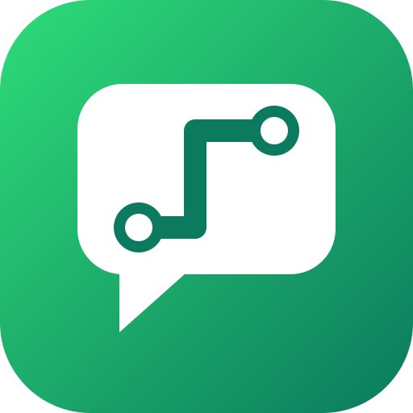
		</a>
		<br>
		Periskope Connector
	</h1>
	<h3>
		see every WhatsApp conversation your sales team has, inside Frappe CRM
	</h3>
	<h5>
		no WhatsApp Business API needed - reps keep using the WhatsApp they already use
	</h5>
</div>

<div align="center">
	<a target="_blank" href="#license" title="License: MIT"></a>
	<a target="_blank" href="https://www.python.org/downloads/" title="Python version"></a>
	<a target="_blank" href="https://frappeframework.com" title="Frappe version"></a>
	<a target="_blank" href="https://docs.periskope.app" title="Periskope docs"></a>
</div>

Sales conversations usually live on each rep's phone, so management cannot see them and handing a customer over to another rep is hard. Periskope Connector captures the WhatsApp messages on your reps' company numbers through [Periskope](https://periskope.app), saves them in Frappe, classifies them with AI, links them to CRM leads and deals, escalates unanswered customers through an SLA ladder, and alerts management to serious issues. Reps keep using the normal WhatsApp or WhatsApp Business app on their own company numbers. Nothing in the app ever sends a WhatsApp message.

> **Status:** feature-complete for the spec (capture, AI tagging, CRM linking, contact queue, SLA escalation, keyword and high-severity alerts, health monitoring, reports).

## Table of Contents
* [Features](#features)
* [How it works](#how-it-works)
* [Installation](#installation)
* [Setup](#setup)
* [User Manual](#user-manual)
  * [What Periskope Connector does](#what-periskope-connector-does)
  * [Before you start](#before-you-start)
  * [Set it up](#set-it-up)
  * [Daily use](#daily-use)
  * [Customise it](#customise-it)
  * [The Flow dialog](#the-flow-dialog)
  * [The AI agent](#the-ai-agent)
  * [Reports and dashboard](#reports-and-dashboard)
  * [Keeping it healthy](#keeping-it-healthy)
  * [Troubleshooting](#troubleshooting)
  * [Reference](#reference)
* [Privacy](#privacy)
* [Roadmap](#roadmap)
* [Development](#development)
* [License](#license)

## Features

- **Message capture:** every message on a linked number, sent or received, is saved as a **Periskope Message** with its direction, sales rep, customer number and attachment details. Duplicate events are ignored; a background sweep recovers deliveries whose job was lost; an hourly back-fill reads each active chat's history from Periskope and saves messages a missed webhook never delivered (older ones with `periskope_connector.backfill.run --kwargs '{"days": 7}'`); a daily sync-health check emails you when a normally busy number goes silent.
- **AI classification:** each text message is put by Claude in one of your **tags** (starting set: `quality_complaint`, `delivery_delay`, `payment_issue`, `sample_request`, `order_or_enquiry`, `general`; add, rename or switch off tags and write their descriptions under **Periskope Tag**), with severity, sentiment, a one-line summary and details such as a promised follow-up time, the customer's name or a competitor's name. Only the customer's text messages are analysed (20 per 5-minute run, chat history as context); acknowledgements, emoji and one-worders are skipped. A sales manager can record the correct category when the AI was wrong — the latest corrections are fed back into the prompt, and the **Periskope Tagging Review** report shows the correction rate. Every call's tokens are logged (**Periskope AI Usage**), an optional monthly budget pauses tagging when reached, and the instructions are editable (with an **Improve Instructions with AI** button).
- **Actions per tag:** each tag has an Actions table: *Create Lead*, *Email Alert* (recipients per row), *Timeline Comment* and *ToDo for Rep*, each from a minimum severity and for 1-to-1 chats, groups or both. The starting rows give the usual behaviour (alert on High, comments on every tag but `general`, lead from an enquiry).
- **CRM linking:** 1-to-1 chats match the customer's number against CRM Lead and Deal (indexed normalised fields, E.164 first so foreign buyers cannot collide; open deals before closed ones). Customer groups match by group name, sender number, the customer name the AI finds, or a lead/deal set by hand on the **Periskope Group**. Classified messages appear on the lead/deal timeline as comments (one per message, burst-merged, or off — your choice; Desk's connections sidebar links the history either way).
- **Lead capture:** unknown 1-to-1 numbers land in the **Periskope Contact** queue with one-click *Create Lead*, *Link to existing* and *Ignore* (personal/vendor/spam/internal) actions, a daily digest to the sales head, dedupe against existing leads, deals and contacts, and an ignore list (optionally fed by ERPNext Supplier/Employee numbers). Automatic lead creation for new enquiries is a switch (off by default).
- **SLA escalation:** unanswered customer messages escalate per chat through the **SLA Levels** table in the settings: each row has the working minutes to wait, a minimum severity and an action (notify the rep, ToDo, email the managers, email the escalation list, or email chosen recipients). The starting rows are a bell at 1 working hour, a ToDo plus manager email at 3, the MD list at 8, and all of them after 30 minutes for High severity. Working hours, working days and a Holiday List (Diwali) are respected; the reply closes everything and records the response time; reports show first-response time per rep and every open escalation.
- **Alerts:** high-severity messages email the managers the moment they are classified, and keyword rules (editable, whole-word, Tamil/Tanglish friendly, per-rule recipients, with a dedupe window so one argument is one alert) catch what the AI files too politely. Every alert is logged for audit.
- **Visibility and control:** a Periskope workspace with shortcuts, dashboards and reports (Tagging Review, Response Time, Open Escalations, Lead Source, AI Usage, Sync Health, Unmatched Numbers); only Sales Manager / System Manager / WhatsApp Manager can read the messages (reps can optionally see their own numbers); a Health tab with live figures; retention settings that clear raw payloads after 90 days by default.

## How it works

```
Rep's phone (WhatsApp)
        |  linked with a QR scan
        v
    Periskope  --- message.created webhook (HMAC signed) --->  Periskope Connector
                                                                     |
                     +-----------------------------------------------+
                     v
        Periskope Message  --->  AI classification (Claude)  --->  category, severity, summary
                     |                |                                     |
                     |                +-> keyword alerts, high-severity alert
                     +--> linked to a CRM Lead or Deal (new enquiry: lead + timeline comment)
                     |
                     +--> unknown number -> Periskope Contact queue (daily digest)
                     |
                     v
        SLA ladder: rep bell -> ToDo + managers -> MD  (working hours, holidays, re-arm)
```

The webhook endpoint accepts calls from anyone but only acts on a request whose `x-periskope-signature` matches your signing secret. It writes nothing until the signature is verified, it is rate limited, and heavy work happens in a background job so Periskope gets its 200 immediately.

## Installation

Requirements:

- Frappe v15 or v16 with [Frappe CRM](https://github.com/frappe/crm) on the site (ERPNext optional: it only adds the Sales Person link and Supplier/Employee ignore lookups)
- A [Periskope](https://periskope.app) account with at least one linked WhatsApp number
- An [Anthropic API key](https://console.anthropic.com) for AI tagging (optional; capture, linking and escalation work without it)
- A site that Periskope can reach over the internet for webhooks

Install the app with the [bench](https://github.com/frappe/bench) CLI — everything else is created for you (roles, custom fields, lead source, starter keyword rules):

```bash
cd $PATH_TO_YOUR_BENCH
bench get-app https://github.com/rs-rethik/Periskope-Connector --branch develop
bench --site $SITE_NAME install-app periskope_connector
bench --site $SITE_NAME migrate
```

## Setup

Open **Periskope Settings**. The **Setup** tab has four steps (connect Periskope, AI key and budget, approvers and sales reps, switch the AI agent on) with a status panel that shows what is still missing; **Health** shows live figures; everything else is in the collapsed sections of **Advanced**. The **Flow** button next to Save opens the whole pipeline as a diagram you can edit. Step-by-step instructions are in the [User Manual](#user-manual).

## User Manual

The manual below is for the people who set the app up and use it every day, with screenshots. It follows the order you need things: set up, daily use, customising, reports, keeping it healthy and troubleshooting.

### What Periskope Connector does

Your sales reps talk to customers on WhatsApp from their company numbers. Periskope Connector collects those conversations in Frappe so management can see them, and does the routine work around them.

1. **Captures** every message on a linked company number, sent or received, through [Periskope](https://periskope.app).
2. **Tags** each customer message with AI: a tag such as *quality_complaint* or *sample_request*, a severity, the customer's mood and a one-line summary.
3. **Links** the conversation to the right CRM lead or deal, and creates a lead when an unknown number asks for something.
4. **Reacts** to the tag with the actions you choose: create a lead, email people, add a timeline comment, give the rep a ToDo.
5. **Escalates** when a customer waits too long for a reply: a bell for the rep, then a ToDo and an email to managers, then an email to the owner.

> **Note** The app sends a WhatsApp message only for the AI agent's replies and for a rep's reply typed in the CRM's WhatsApp tab (see [The AI agent](#the-ai-agent)). The agent is off until you switch it on, and test mode limits who can receive messages. Reps can keep using WhatsApp or WhatsApp Business as they do today.

##### Who uses it

| Person | What they do |
|---|---|
| System Manager | Sets the app up and changes its settings. |
| Sales Manager, WhatsApp Manager | Read the messages, reports and dashboard, correct tags, work the contact queue. |
| Sales rep | Gets bells and ToDos. Can also read the messages of their own number if the option is switched on. |

### Before you start

Have these ready. Setup takes about fifteen minutes.

| You need | Why |
|---|---|
| A Periskope account on a plan that includes the API | Periskope only allows API access on a Pro or Enterprise plan. Without it the connection fails with a plan message. |
| At least one WhatsApp number linked in Periskope | This is the company number the reps use. |
| The site's public https address | Periskope sends messages to your site, so it must be reachable from the internet. For a test site, use a tunnel such as ngrok. |
| An Anthropic API key | Used for the AI tags. Capture, linking and escalation work without it. |
| An outgoing Email Account on the site | Alerts and escalations are sent by email. Without one they fail and are logged in the Error Log. |
| The Frappe scheduler and a worker running | The AI tags, reminder checks and the hourly catch-up run as scheduled jobs. |

> **Important** The key, the signing secret and the Anthropic key are secrets. Enter them in the settings form yourself and do not share them.

### Set it up

Everything is configured on **Periskope Settings** (open it from the **Periskope** workspace). The **Setup** tab has four steps, and the panel at the top shows which are done and what is still missing. The AI agent cannot be switched on until steps 1 to 3 are done.

| Step | What you enter | Check |
|---|---|---|
| 1. Connect Periskope | Tick **Enable Periskope Integration**, paste the **Periskope API Key** (Periskope console, Settings, Integrations, API), save. Under *Receive Messages* copy the **Webhook Signing Secret** from Periskope (Settings, Webhooks). | **Test Connection**: checks the key, fills the company numbers and registers the webhook. |
| 2. AI | The **AI Provider** and **AI API Key** (Anthropic), and a **Monthly Token Budget**. | **Test AI**: the result is shown in *AI Status*. |
| 3. Team | **Approver Emails**: who approves the changes the agent suggests (users with the WhatsApp Manager, Sales Manager or System Manager role). The **Default Sales Rep** and the rep for each company number: they get the follow-up tasks. | The panel names any approver that is not an active user with an approver role. |
| 4. AI Agent | Tick **Enable AI Agent**, and set the **Reply Delay**. | The panel shows *Running*. |

A new install already contains the starting tags, keyword rules, SLA levels, AI instructions and holding message, so these four steps are all that is needed.

> **Important** The keys and the signing secret are secrets. Enter them in the form yourself and do not share them.

> **Tip** If the Webhook URL shows a local address, set the site's public address first (`host_name` in the site config, for example your ngrok address) and save again. Periskope can only call an https address.

#### Where everything else lives

What the agent maintains itself has its own list, so the settings page stays short. The agent changes these only through approved suggestions; admins can still open and edit them.

| What | Where it lives now |
|---|---|
| Tags and what each tag does (lead, alert, timeline note, task) | **Periskope Tag** |
| Keyword rules | **Periskope Keyword Rule** (was a table in the settings) |
| SLA / escalation levels | **Periskope SLA Level** (was a table in the settings) |
| Numbers to ignore | **Periskope Contact** with an *Ignored* status (the *Ignore List* text field is gone) |
| Group to customer mapping | **Periskope Group** (lead, deal or **organization**) |
| Lead creation rule | The *Create Lead* action on a tag |
| Knowledge for auto replies | The **Knowledge Base** canvas (each node is a **Periskope Knowledge Entry**) |

Everything technical is in the collapsed sections of the **Advanced** tab: AI tagging options and instructions, auto reply details (variation, confidence, caps, holding message, when the AI resumes after a rep takes over), learning and approval timings, working hours and escalation emails, lead and contact options, CRM visibility, data retention, webhook events, voice notes (Gemini key) and **Test Mode**.

#### Test mode

Test mode is on until an admin switches it off (Advanced, Test Mode). While it is on:

- a WhatsApp message (auto reply, holding message, or a rep's reply from the CRM) goes out only to the **Allowed Chats**; a group never gets one, even when it is listed. For every other chat the reply is prepared and logged as a dry run, and nothing is sent;
- the agent writes notes, tasks and status changes only for allowed chats; for the others it logs what it would have written;
- email reaches only the **Allowed Emails**. Other recipients are dropped from every email the site sends.

Everything that was sent, blocked or only simulated is a row in **Periskope Agent Action**.

### Daily use

#### Messages

Open **Messages** from the workspace. Each message shows who sent it, the rep, the number, the text, and once tagged: the tag, severity, sentiment, a summary, and a link to the CRM lead or deal.


*A message as soon as it arrives. The AI tag fills in at the next 5-minute run.*

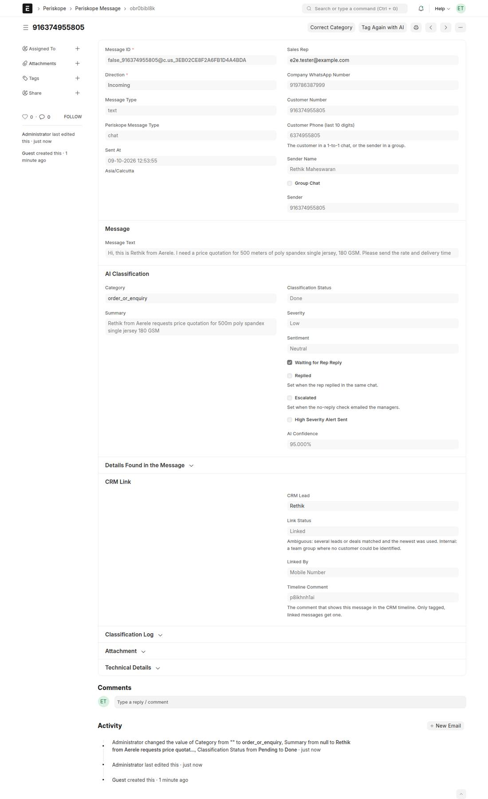
*The same message after tagging: tag, summary, products, customer name and the linked CRM lead.*

A message waits as **Pending** until the AI job picks it up (every 5 minutes, 20 messages at a time). **Skipped** means it was not sent to the AI and the reason is shown, for example *Sent by the rep* or *Too short to tag*.

#### In the CRM

A message is linked to a lead or deal by the customer's mobile number. Open the lead in Frappe CRM or in Desk and the tagged messages appear on its timeline, with the AI summary.

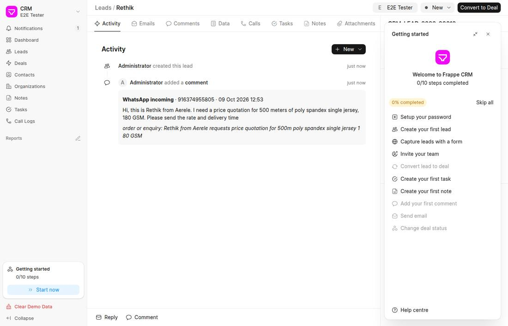
*A WhatsApp message on the timeline of a lead in Frappe CRM.*


*The same lead in Desk, with the message and AI summary.*

For groups, the app looks for the customer by group name, by the sender's number, or by a customer name the AI finds in the text. You can also link a group to a lead or deal by hand in **Periskope Group**. Messages in a team group where no customer is found are marked *Internal*.

#### Unknown numbers: the contact queue

A number that is not on any lead, deal or contact goes to **Periskope Contact**. From a contact, use **Actions**:

| Action | What it does |
|---|---|
| Create Lead | Makes a CRM lead for the number, links all its earlier messages and adds one summary comment to the lead. |
| Link to existing | Writes the number onto a lead or deal you choose and links the history. |
| Ignore | Marks it personal, vendor, spam or internal. It stays out of the queue and is never turned into a lead. |

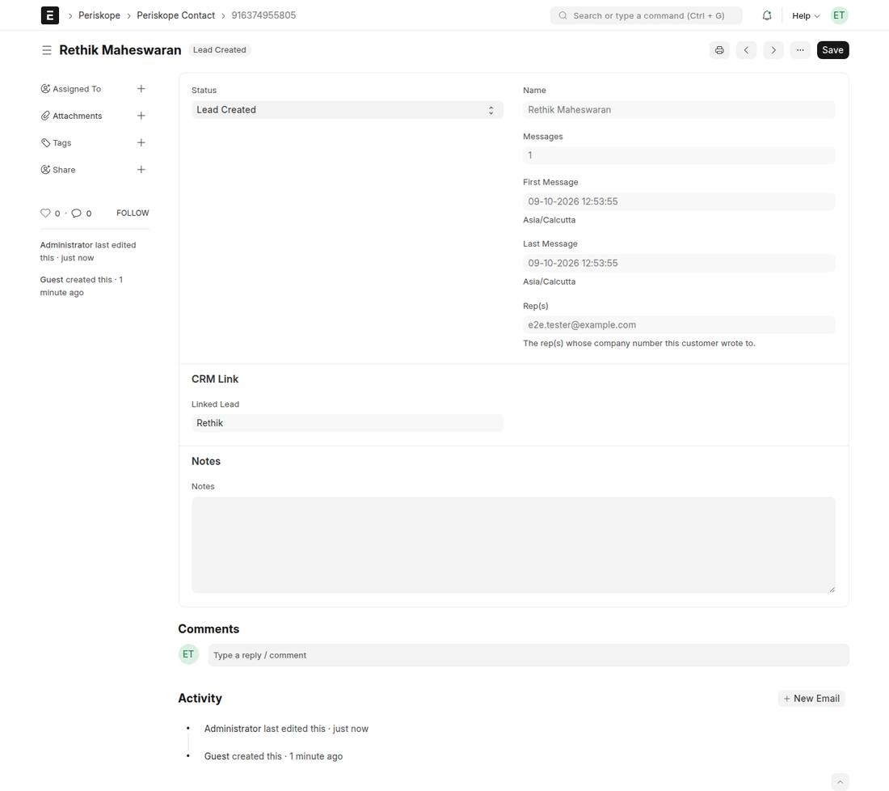
*A contact after a lead was created. Its status changes to Lead Created.*

If automatic lead creation is on, an enquiry from an unknown number goes straight to **Lead Created**. Otherwise it waits in the queue as **New**, and the digest email lists it each day.

#### Alerts you will receive

Alerts arrive both as email and as a bell notification in Frappe.

| Alert | When |
|---|---|
| High severity message | The AI rates a message High (angry customer, rejection, risk of losing an order, legal threat). One alert per message. |
| Keyword alert | A message contains a word from one of your keyword rules. |
| Reply reminder | A customer is waiting for a reply (see below). |
| Budget alert | The monthly AI token budget is reached. |
| Silent number | A normally busy company number has sent no messages today. |

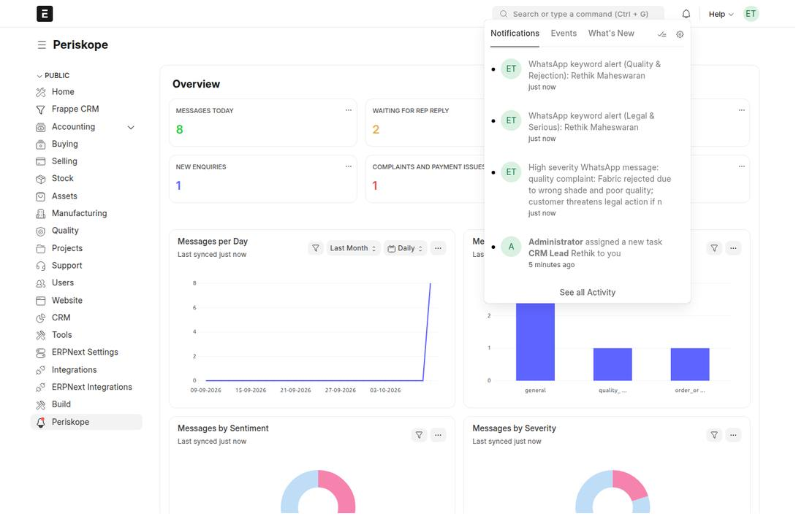
*Alerts in the bell.*

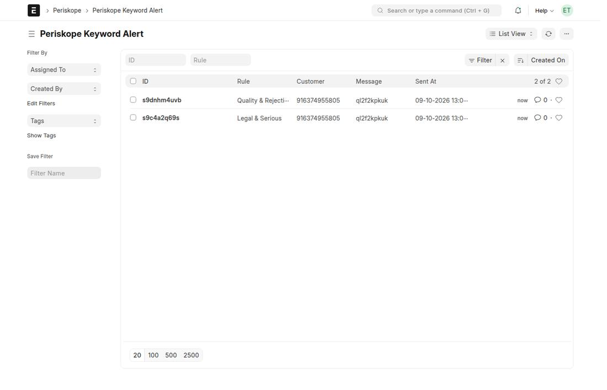
*The Keyword Alert list records every alert sent.*

#### When a customer is waiting

The app checks every 10 minutes during working hours. When a customer's message needs a reply and no rep has answered, the SLA levels run in order. With the starting levels:

| Waiting (working time) | What happens |
|---|---|
| 1 hour | The rep gets a bell notification. |
| 3 hours | The rep gets a ToDo and the managers get an email. |
| 8 hours | The escalation list (the owner) gets an email. |
| 30 minutes, High severity | All four of the above, straight away. |


*Reply reminders: one row per waiting customer, with the level reached.*


*The ToDo created for the rep.*

When any rep replies in the chat, the reminder closes, its ToDo is closed and the time to the first answer is recorded. A new customer message after that starts a fresh cycle. In a group chat, any rep's message counts as the reply (when groups are included).


*A closed reminder with the first-response time.*

### Customise it

Nothing about tags, actions or the escalation ladder is fixed in code. Change them in Desk.

#### Tags

Open **Tags** from the workspace. A tag is a name and a description that is given to the AI, so the description decides what the AI puts under it. You can add tags, edit descriptions, switch tags off, and choose which tag is the **Default Tag** (used when the AI cannot place a message and for skipped messages). A tag name is lowercase letters, numbers and underscores and cannot be changed once saved. At least one tag must stay active.


*The starting tags.*


*Adding a tag: a name, a description for the AI and its actions.*

#### Actions on a tag

Each tag has an **Actions** table. Each row says what the app does for a message with this tag, from which severity, and for which chats.

| Action | What it does |
|---|---|
| Create Lead | Makes a CRM lead from an unknown 1-to-1 number. Also needs the lead creation setting to be on. |
| Email Alert | Emails the row's recipients, or the Manager Emails when empty. One email per message, even if several rows match. |
| Timeline Comment | Shows the message and its summary on the lead or deal timeline. |
| ToDo for Rep | Gives the rep a ToDo for the message, once. |

**From Severity** is Low, Medium or High: the row runs for that severity and above. **Chat Type** is Any, 1-to-1 or Group. A tag with no rows only labels the message.

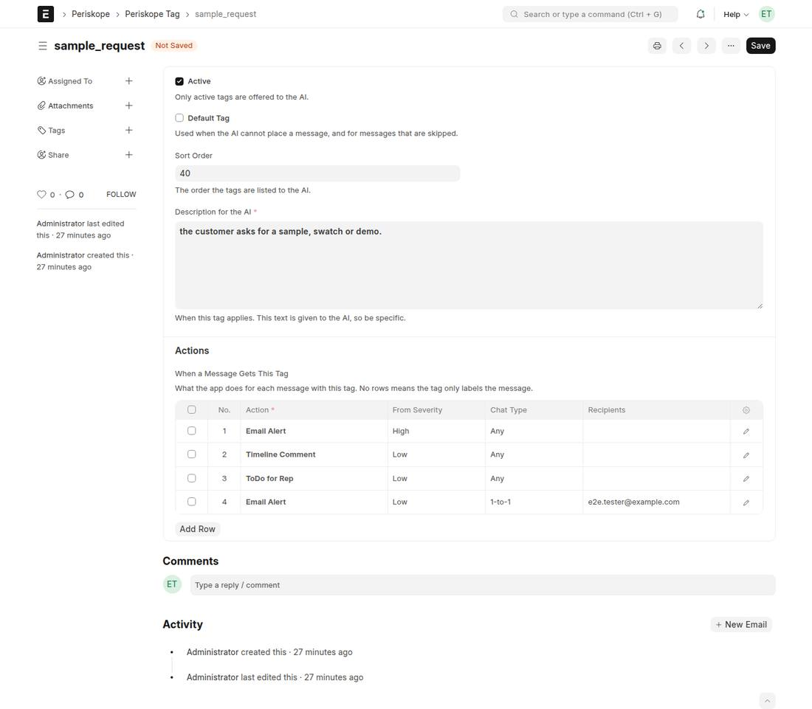
*Two rows added to a tag: a ToDo for the rep and an email to a chosen person.*

| Tag | Starting actions |
|---|---|
| quality_complaint, delivery_delay, payment_issue, sample_request | Email Alert from High, Timeline Comment |
| order_or_enquiry | Email Alert from High, Timeline Comment, Create Lead for 1-to-1 chats |
| general (default) | Email Alert from High only |

#### SLA levels

The **Periskope SLA Level** list is the escalation ladder (the agent may suggest changes; you approve them, or edit the list yourself). Each row has the working minutes to wait, the lowest severity it applies to, and an action: *Notify Rep*, *ToDo for Rep*, *Email Managers*, *Email Escalation List* or *Email Recipients* (with addresses on the row). Rows run in order of waiting time. The same action to the same recipients runs once per waiting period, and an email that fails is tried again at the next check.

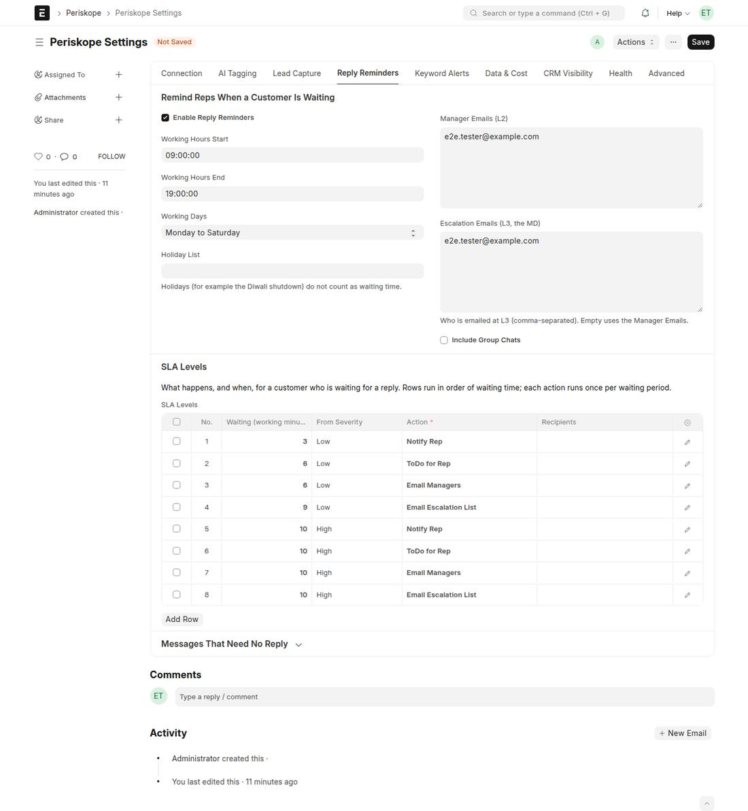
*Editing the SLA levels.*

> **Tip** To test the ladder quickly, set short waiting times (for example 3, 6 and 9 minutes), then use **Actions, Check Reply Reminders Now**. Restore the real times afterwards.

#### AI instructions, corrections and re-tagging

- The **AI Instructions** section shows the instructions the AI follows. Edit them freely. **Improve Instructions with AI** suggests a better version for you to review, and **Reset AI Instructions** restores the original. The tag list is added automatically, so the instructions do not list tags.
- When the AI picks the wrong tag, open the message and press **Correct Category**, then choose the right tag. The latest corrections are given back to the AI as examples. The **Tagging Review** report shows how often it is corrected.
- **Tag Again with AI** on a message runs the AI on it once more.


*Correct Category on a message.*

#### Other settings

See *Where everything else lives* above: the rarely needed options are in the collapsed sections of the **Advanced** tab.

### The Flow dialog

The **Flow** button next to **Save** on Periskope Settings opens a dialog that draws the whole pipeline: capture, linking, AI tagging, tags and their actions, the contact queue, the reply escalation, and the AI agent (auto reply, CRM updates, learning agent). Each step is a card with a coloured bar for its health (green working, orange needs a look, red not working, grey off) and a live figure. Click a step to open its panel on the right of the diagram (under it on a narrow screen).

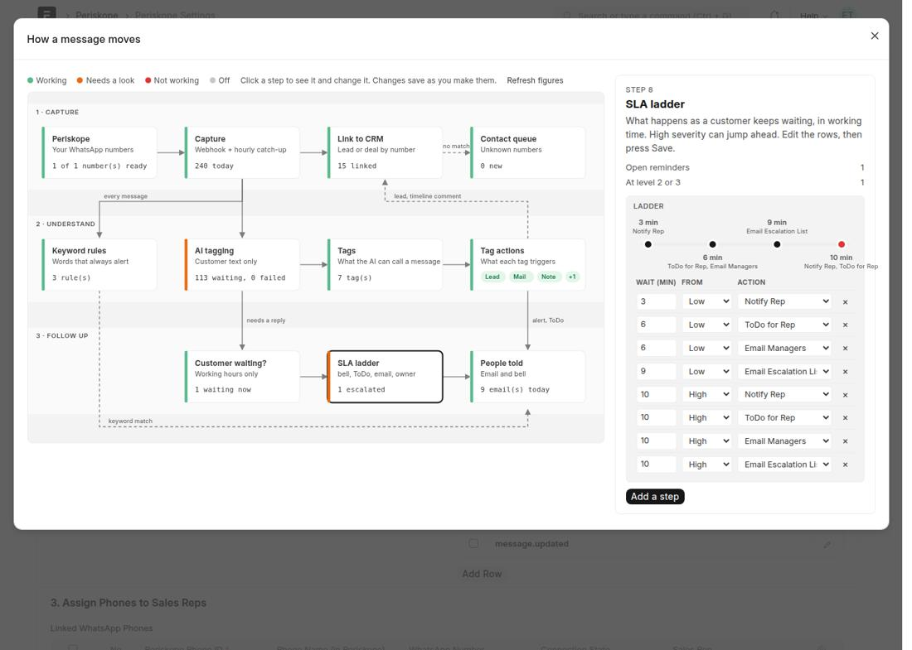
*The Flow dialog with the SLA ladder open. The waiting times are the shortened ones from the test site; a new install starts at 60, 180 and 480 minutes.*

**Every change in the dialog is saved as you make it.** Switching a switch on or off, editing an SLA row, adding or removing a step, or changing an email saves the settings at once and shows "Saved". Tags and tag actions are separate records and save through their own calls. There is no Save button to press.

What you can change in a panel:

| Step | Edit in the panel |
|---|---|
| Periskope, Capture | Test Connection, create the webhook, switch the integration on or off |
| Link to CRM, Contact queue | Timeline comment mode, rep access, lead creation, supplier and employee ignore switches |
| Keyword rules | Recipients and the on/off switch of each rule |
| AI tagging | Tagging and group tagging switches, Test AI Connection |
| Tags | Switch a tag on or off |
| Tag actions | Tick a tag against Lead, Mail, Note or ToDo |
| Customer waiting, SLA ladder, People told | Reminder switches, working hours, the SLA rows, manager and owner emails |

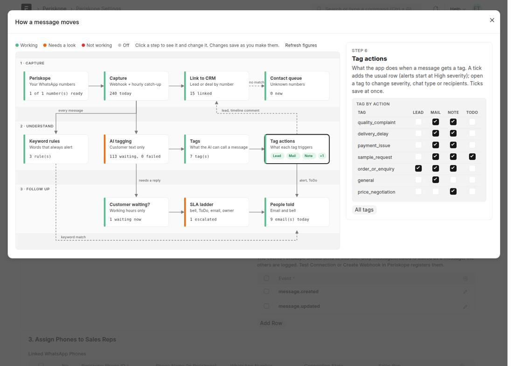
*Tag actions: one tick per tag and action.*

A tick adds the usual row (an email alert starts at High severity); open the tag to change severity, chat type or recipients. The default tag and the last active tag cannot be switched off. The buttons that open other pages (a tab, a list or a report) close the dialog first.

### The AI agent

With **Enable AI Agent** on, the agent handles conversations by itself: it tags messages, replies, links and updates CRM records, alerts, escalates and creates follow-ups. It asks for approval only when it wants to change the setup.

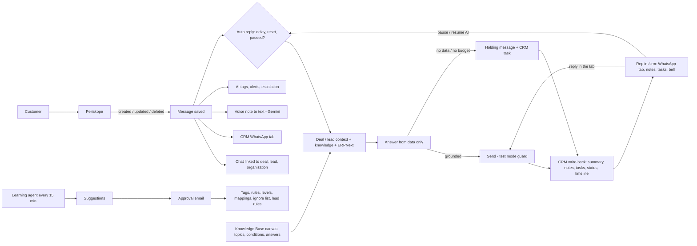

#### What the rep sees in the CRM

Reps work only in **/crm**. On each lead or deal:

- **WhatsApp tab**: the whole conversation. Messages from the agent start with *AI assistant:*. A rep can reply in the tab; the message goes out through Periskope from the company number, and the AI pauses in that chat (it resumes on its own after *AI Resumes After*, default 24 hours, or with **Resume AI replies**).
- **Pause AI replies / Resume AI replies** in the page header.
- **Notes**: one *WhatsApp summary* (what the customer wants, what was answered, what is pending), kept up to date, and one note per topic the customer told us about (requirements, quantities, delivery, payment terms, contact person, complaint), updated instead of repeated.
- **Tasks**: a follow-up when the rep must act, with a clear title, reason and due date, and always one when the agent sent the holding message. One open task per chat and reason; marking the reply task done closes the reply reminder.
- **Activity**: a comment for each AI reply.
- **Bell**: new customer messages, waiting customers and escalations.
- **Status**: moved forward when the conversation clearly shows it (for example New to Contacted). Won, Lost and On Hold are never set by the agent; it creates a *Confirm: mark as ...?* task for the owner instead.

No ids, confidence figures or raw data appear on these records.

#### Auto reply

After the **Reply Delay** (plus a small random variation) since the customer's last message:

- A newer message moves the timer; a rep's reply cancels it and pauses the AI in that chat.
- Before answering, the agent reads the deal (or lead): status, owner, notes, open tasks, recent activity and the last quotation. The last quotation and the deal stage may be quoted to the customer; the rest is background only.
- The answer may use only the approved knowledge entries, ERPNext items (price and stock), open sales orders and the last quotation. Every number in it must appear in that data.
- If the data does not answer the question, or there is no AI key, or the monthly budget is used up, the customer gets the **Holding Message** and the rep a task. The admins get one email a day about a missing key or budget.
- Captions of photos and documents are read; voice notes are transcribed with Google Gemini when a key is set (Advanced, Voice Notes).
- An edited message is tagged again; a deleted message no longer waits for a reply, and the CRM tab shows *This message was deleted*.

Each attempt is a **Periskope Auto Reply** row; each action the agent took is a **Periskope Agent Action** row.

#### The learning agent and approvals

Every 15 minutes the agent reads the conversations that have been quiet for an hour. It builds the knowledge base from answers the reps gave, and suggests changes to tags, keyword rules, SLA levels, a few settings, **group to customer mappings**, **numbers to ignore** and **lead creation rules**. A suggestion needs evidence from several conversations, and its target must exist.

One email to the approvers lists the suggestions with *Approve* and *Reject* buttons. Each button opens a page that asks for one confirming click, each link works once, and links expire. Approvers can also decide from **Periskope Suggestion** in Desk. Nothing changes until someone approves; a rejected suggestion is not proposed again for 30 days.

#### Knowledge Base canvas

Admins (System Manager, WhatsApp Manager) open **Knowledge Base** from the workspace, or from the *Learning agent* step of the Flow dialog. It shows the knowledge base as a node graph, like a workflow builder:

- **Customer asks** starts the tree. **Topic** nodes (Delivery, Pricing) branch into **Condition** nodes (*Customer is in Chennai*, *Otherwise*) and end in **Answer** nodes (*Delivery to Chennai takes 2 days*). An answer can also hang straight under a topic or under Customer asks.
- Click **+** after a node to add the next one, or drag from a node's right dot onto another node to connect them; drop it on empty canvas to add a node there. Hover a wire to remove it. Drag nodes to arrange them; scroll to move, Ctrl + scroll to zoom, and **Tidy up** lays the tree out again.
- Click a node to edit it in the side panel. **Delete** retires the node and everything after it, so the agent stops using them.
- **Import document** (PDF, Excel, Word, CSV): the AI extracts answers from a price list, FAQ or catalogue. You tick the ones to keep and pick where they go; nothing is saved before that.
- **Knowledge gaps** lists what customers asked in the last 14 days that the agent answered with the holding message, each with *Add an answer*.
- Answers the learning agent mined from rep replies appear with a dashed border and *Waiting for approval* until an approver accepts them.

How a reply uses it: a customer's message matches an answer by its own words, or by one word of a topic's name or keywords. All answers under that topic go to the AI with their conditions (*Applies only when: Customer is in Chennai*). The AI uses an answer only when the chat or the CRM record shows its condition holds; when it cannot tell which branch applies, the customer gets the holding message.

### Reports and dashboard

The **Periskope** workspace opens on a dashboard with the things that need attention first.

- **Needs attention:** customers waiting for a rep reply, open escalations, high severity issues, new contacts in the queue, AI tagging failures, and the issues of the last 7 days.
- **Overview:** messages today and the enquiries of the last 7 days, then charts of messages per day, by tag, by sentiment and by severity.
- **Shortcuts:** **Flow** (opens the settings with the Flow dialog already open), Settings, Messages, Tags, Reply Reminders, Contact Queue, Keyword Alerts and Webhook Logs.
- **Reports:** every report below, and a list of all the app's pages.

The *Enquiries* and *Issues* cards follow your tags, not fixed tag names. Each tag has a **Dashboard Group** field (Enquiry, Issue, or empty): a card counts the incoming messages of the last 7 days whose tag is in its group. A new site starts with `order_or_enquiry` as Enquiry and `quality_complaint` and `payment_issue` as Issue.

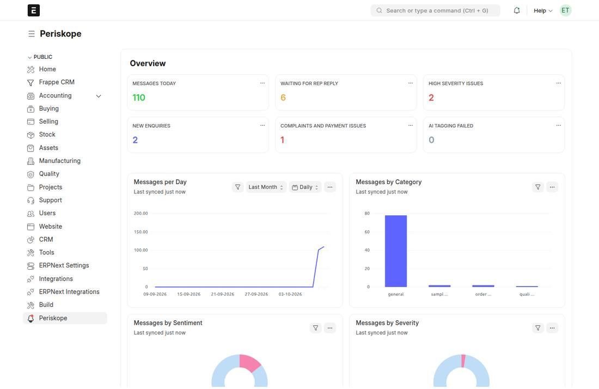
*The workspace with live counts and charts.*

| Report | What it answers |
|---|---|
| Open Escalations | Which customers are waiting right now, at what level, and who was told. |
| Response Time | How fast each rep answers, in working time. |
| Tagging Review | How often managers corrected the AI, by tag. |
| Lead Source | How many leads came from WhatsApp. |
| AI Usage | Tokens used per day and model. |
| Sync Health | Messages per company number, to spot a silent number. |
| Unmatched Numbers | Numbers and groups that could not be linked to a lead or deal. |

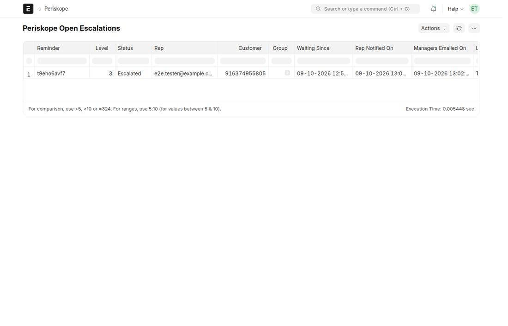
*Open Escalations.*

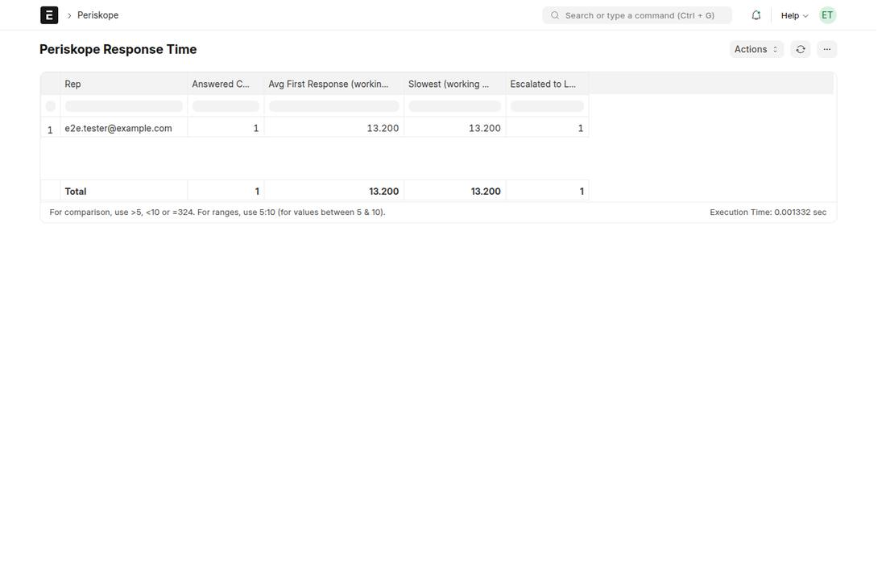
*Response Time.*

### Keeping it healthy

#### The Health tab

The **Health** tab in the settings shows live figures: when the last webhook arrived, when the AI last ran, how many messages wait to be tagged, how many failed, unprocessed webhook logs, tokens used this month, and messages per phone in the last 24 hours.

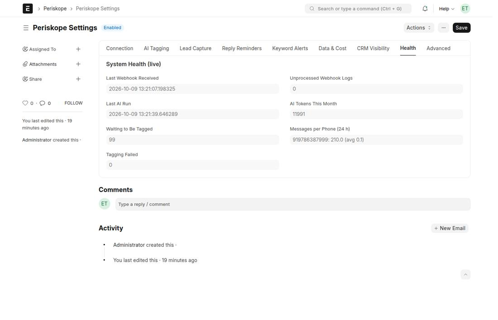
*The Health tab.*

#### Missed messages

Webhooks can be lost if the site is down. Every hour the app reads the last day of each active chat from Periskope and saves any message it does not have, then tags and links it like any other. A message that was recovered this way and is still unanswered escalates like a live one. To look further back, run the catch-up by hand. Use up to 30 days:

```bash
bench --site your.site execute periskope_connector.backfill.run --kwargs '{"days": 7}'
```

The webhook log is also checked every 30 minutes for messages that were received but never saved, and they are saved again.

#### Webhook log

**Webhook Logs** keeps every call from Periskope. A call with a missing or wrong signature is refused and writes nothing.

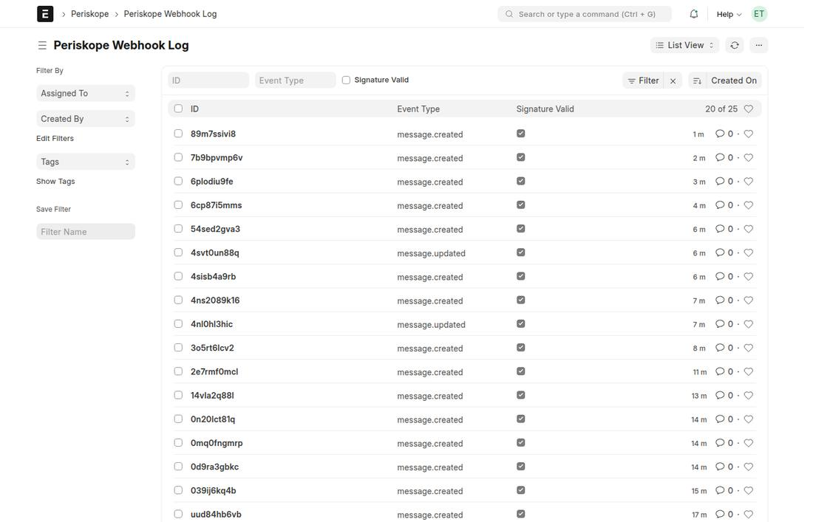
*The webhook log.*

#### Privacy

The text of tagged messages is sent to your AI provider. Only company numbers linked in Periskope are captured, and personal numbers can go on the ignore list. Tell staff that business WhatsApp numbers are monitored for record-keeping. Raw webhook data is cleared after 90 days by default, and message text can be given its own retention.

### Troubleshooting

| What you see | Likely cause and fix |
|---|---|
| Test Connection says Periskope rejected the API key (401) | The key is wrong, or the account is not on a plan with API access. The message from Periskope names the plan. Fix the plan or use a key from the right organisation. |
| No messages arrive | Check the integration is enabled, the Webhook URL is the public https address, the webhook exists in Periskope (run Test Connection), the signing secret matches, and your tunnel is still running. A tunnel address changes every restart on the free ngrok plan. |
| Messages arrive but stay Pending | The AI is off, the key is missing, or the scheduler or worker is not running. Check the Health tab and the Error Log. |
| Webhook URL shows a local or http address | Set the site's public address in the site config and save the form. |
| No alert or escalation emails | The site has no default outgoing Email Account. Create one under Email Account. Failures are written to the Error Log. |
| A keyword rule never alerts | The rule has no recipients, or the same rule already alerted in that chat inside the dedupe window. |
| Customers wait but nothing escalates | Reply Reminders is off, the time is outside working hours, the SLA Levels table is empty, or the message was skipped as needing no reply. |
| A report or workspace link shows an error | Run `bench migrate` so the reports install. |
| Tagging stopped and managers got a budget email | The monthly token budget was reached. Raise it under Data and Cost. |

### Reference

#### Severity

Low: ordinary. Medium: a real problem that is not yet serious. High: an angry customer, a rejection, a risk of losing an order, a legal threat, fraud, abuse, or a payment outside the company.

#### Starting tags

| Tag | The AI uses it when |
|---|---|
| quality_complaint | A complaint about shade, GSM, shrinkage, pilling, wash fastness, damage, wrong goods or rejection. |
| delivery_delay | Delivery is late or the customer asks where the order is. |
| payment_issue | An invoice or payment dispute, overdue payment, a refund, or payment outside the company. |
| sample_request | The customer asks for a sample, swatch or demo. |
| order_or_enquiry | An enquiry, a price or quotation request, a product question, or placing or repeating an order. |
| general | Anything else. |

#### Schedule

| Job | How often |
|---|---|
| Tag waiting messages with the AI | Every 5 minutes, 20 messages |
| Reply reminder and escalation check | Every 10 minutes, in working hours |
| Learning agent (knowledge base, suggestions, approval email) | Every 15 minutes, when enabled |
| Auto reply: send the replies that are due | Every minute, when enabled |
| Re-queue webhook logs that were never saved | Every 30 minutes |
| Catch up on missed messages | Every hour, last 24 hours |
| Silent number check, token budget check, contact digest | Daily |
| Unmatched numbers report | Weekly |
| Clear old raw data | Monthly |

## Privacy

The learning agent and the auto reply send message text (and, for the reply, the matching item, price and order data) to the same AI provider. Message text is sent to the AI provider you configure — Anthropic by default; the GLM/Z.ai and Jarvis options send it to those providers instead, so choose them only if that fits your policy. Only company numbers linked in Periskope are captured; personal or mixed-use numbers can be excluded on the ignore list, and staff should be told that business WhatsApp numbers are monitored for record-keeping. Raw webhook payloads are cleared after 90 days by default and message text can be given its own retention. Under India's DPDP Act 2023 the operator remains the data fiduciary for this processing.

## Roadmap

- [x] Periskope connection, webhook receiver and message capture
- [x] AI classification into six categories, with feedback loop and spend controls
- [x] Link messages to CRM leads and deals; lead capture via the contact queue
- [x] SLA escalation with working hours and holidays; keyword and high-severity alerts
- [x] Health monitoring, reports, retention
- [x] History back-fill and webhook creation through the Periskope API
- [ ] Handle edited and deleted messages — only `message.created` is stored; other events are logged
- [ ] Callyzer SIM call logging (a later project, reusing the same linking pattern)

## Development

Run the tests on a development site. They roll back everything they write and never touch your saved API keys, but they do run against the site's database:

```bash
bench --site $SITE_NAME run-tests --app periskope_connector
```

Following the Frappe standard, each doctype has its tests in `test_<doctype>.py` next to its controller, for example `periskope_connector/periskope_connector/doctype/periskope_message/test_periskope_message.py`. Tests for reports sit beside the reports, and the `tests/` folder holds only the shared helpers (`utils.py`) and the checks that cover the whole app (`test_system.py`).

The repo uses `pre-commit` (ruff, eslint, prettier). Enable it once with `pre-commit install` in this folder.

Useful commands:

```bash
# classify the messages that are still waiting for the AI (the scheduler does this every 5 minutes)
bench --site $SITE_NAME execute periskope_connector.ai.classifier.classify_pending

# run the SLA / reminder check by hand
bench --site $SITE_NAME execute periskope_connector.reminders.run

# re-link messages that could not be matched, and back-fill the contact queue
bench --site $SITE_NAME execute periskope_connector.linking.link_unlinked
bench --site $SITE_NAME execute periskope_connector.contacts.backfill_contacts
```

## License

This repository has been released under the [MIT License](license.txt).
